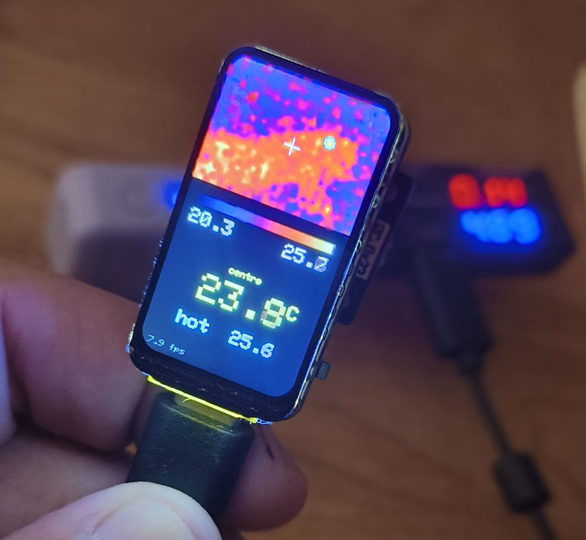
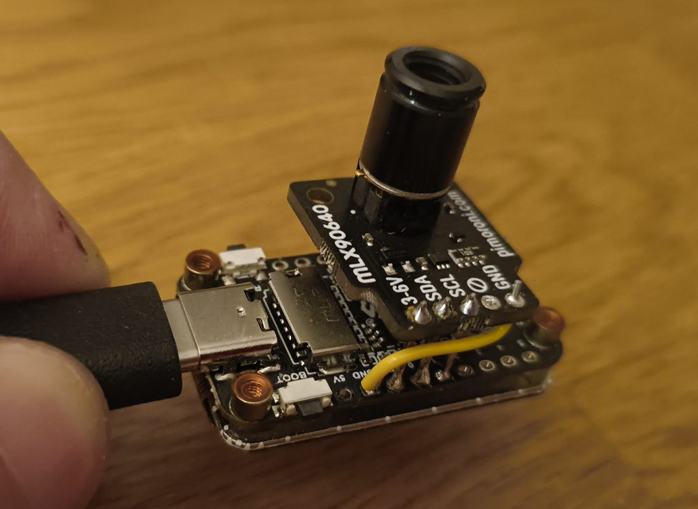
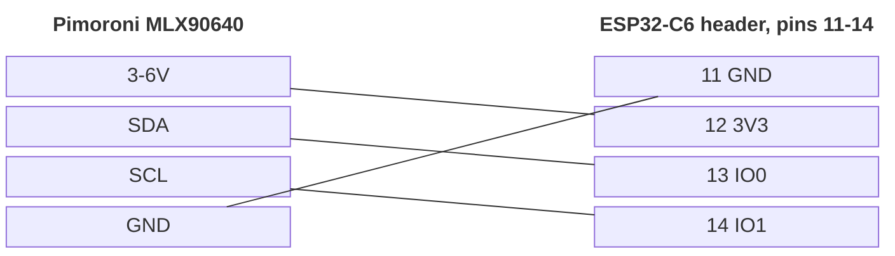

# DIY IR Camera

A pocket thermal camera built from a Waveshare ESP32-C6-LCD-1.47 board and a
Pimoroni MLX90640 thermal camera breakout. The board is held upright
(portrait); the 32×24 sensor image is smoothed up to 172×129 and shown in an
ironbow palette, with a colour scale, min/max, a large (smoothed) centre-spot
temperature, and a cyan ring marking the hottest spot with its temperature.

<p align="center">
  
  
</p>

Open [`mockup/screen-mockup.html`](mockup/screen-mockup.html) in a browser for
an animated, pixel-accurate preview of the screen using simulated sensor data
(press its BOOT button to try the freeze).

## Hardware

| Part | Notes |
|---|---|
| [Waveshare ESP32-C6-LCD-1.47](https://www.waveshare.com/esp32-c6-lcd-1.47.htm) | ESP32-C6, 4 MB flash, 1.47" ST7789 172×320 LCD, microSD. Also sold by [Electrokit](https://www.electrokit.com/en/utvecklingskort-med-esp32-c6-och-microlcd-172x320px) (art. 41023184). Headers come unsoldered. |
| [Pimoroni MLX90640 breakout](https://shop.pimoroni.com/en-eu/products/mlx90640-thermal-camera-breakout) | 32×24 thermopile array, I²C address 0x33, 3–6 V supply, Qw/ST connector. Available in 55° and 110° field-of-view versions. |

## Wiring

Four wires to four neighbouring pins, 11–14 on the board's pin 10–18 header
(pin numbers from Waveshare's
[schematic](https://files.waveshare.com/wiki/ESP32-C6-LCD-1.47/ESP32-C6-LCD-1.47_schemetics.pdf)):

| MLX90640 | ESP32-C6-LCD-1.47 |
|---|---|
| GND | pin 11, **GND** |
| 3–6V | pin 12, **3V3** |
| SDA | pin 13, **GPIO0** |
| SCL | pin 14, **GPIO1** |
| INT | not connected |

GPIO0 and GPIO1 are the ESP32-C6's optional 32 kHz crystal pins. This board
has no 32 kHz crystal, and they aren't strapping pins, so they're free for I²C.



Power the breakout from **3V3, not 5V**: its I²C pull-ups go to its supply, so
3.3 V keeps SDA/SCL at levels the ESP32 can take. Check the silkscreen for which
end of the header is pin 10 (5V) before soldering.

### Board pin usage

| Header pin | Signal | Use |
|---|---|---|
| 1 | IO9 | BOOT button / strapping pin; used as the freeze button |
| 2–5 | IO18, IO19, IO20, IO23 | free |
| 6–7 | IO12, IO13 | USB D−/D+, avoid |
| 8–9 | RXD, TXD | UART0 |
| 10 | 5V | |
| 11 | GND | MLX90640 GND |
| 12 | 3V3 | MLX90640 power |
| 13–14 | IO0, IO1 | MLX90640 SDA, SCL |
| 15–16 | IO2, IO3 | free |
| 17–18 | IO4, IO5 | microSD CS, MISO, avoid |

On-board, not on the headers: LCD on GPIO6 (MOSI), 7 (SCLK), 14 (CS), 15 (DC),
21 (RST), 22 (backlight); RGB LED (WS2812) on GPIO8.

## Building and flashing

The project uses [PlatformIO](https://platformio.org) with the community
[pioarduino](https://github.com/pioarduino/platform-espressif32) platform,
because the official espressif32 platform doesn't ship Arduino core 3.x, which
the ESP32-C6 needs.

```sh
make                 # numbered menu of everything below
make build           # build
make flash           # build and flash (port auto-detected; PORT=... to override)
make monitor         # interactive serial monitor
make compiledb       # refresh compile_commands.json for your editor
make setup           # one-time: pip in PlatformIO's venv, fetch the submodule
```

The Makefile calls `~/.platformio/penv/bin/pio` directly.

If the upload can't connect, hold **BOOT** while plugging in USB, then retry.

If you run `pio` by hand and it complains about the Python version, you may
have an old PlatformIO on your PATH; use `~/.platformio/penv/bin/pio` instead.

## Using it

Hold the board upright and point the sensor at something. Press **BOOT** to
freeze the current frame (a red `HOLD` appears bottom right); press it again
to go live.

Hold **BOOT** for about half a second to open the menu. A short press steps
through *Spot off*, *Hot spot* and *Cold spot*; holding again selects
and closes the menu (it also closes by itself after 6 s). A `*` marks the
current choice. Only one spot is shown at a time: the hottest (default) or
the coldest, both marked with a cyan ring.

### Live view over Wi-Fi

The camera runs its own open Wi-Fi network, **IR-Cam** (the name is shown at
the bottom of the screen). Join it from a phone or laptop and the sign-in page
opens by itself with the live image, the readouts and the options (spot off /
hot / cold, freeze, save image). If it doesn't, browse to
`http://192.168.4.1`. Saving the image works best from a normal browser tab
rather than the sign-in window. The network has no internet access. To give it
a password, set `AP_PASSWORD` in `src/web.h`.

Don't hold BOOT while resetting or plugging in, as that puts the
ESP32 into its bootloader.

## How it works

1. **Startup** reads the sensor's 832-word EEPROM at 400 kHz, extracts the
   calibration parameters, then switches the bus to 1 MHz. The sensor is set to
   chess-pattern readout, 18-bit ADC and 16 Hz subpage rate.
2. **Each frame** reads two subpages (about 8 complete frames per second),
   converts them to temperatures with `MLX90640_CalculateTo`, and patches any
   broken or outlier pixels listed in the EEPROM.
3. **Readouts:** the centre temperature (mean of the 4 middle pixels) is
   smoothed over about half a second so it's easy to read; the image itself
   isn't smoothed. The hot-spot marker sits on the hottest pixel, refined to
   sub-pixel position from its 3×3 neighbours so it doesn't jump around.
4. **Auto-range** takes the frame's min and max, keeps at least a 5 °C span so
   a uniform scene doesn't amplify noise, and smooths the range 30 % per frame
   to avoid flicker.
5. **Rendering** bilinearly interpolates 32×24 → 172×129 into an RGB565 buffer
   and pushes it to the LCD in one SPI transfer, then draws the crosshair and
   temperature text. The ESP32-C6 has no FPU, so interpolation runs in fixed point
   (about 9 ms per frame; the float version took about 320 ms).

Measured per full frame at 8 Hz (with the earlier 224×168 image): about
115–175 ms reading and waiting on the sensor, 46 ms converting to
temperatures, 9 ms interpolating and 20 ms pushing to the LCD. At 16 Hz the camera measures 7.9 fps, close to the sensor's 8 fps limit.

## Settings

At the top of [`src/main.cpp`](src/main.cpp):

| Setting | Default | Meaning |
|---|---|---|
| `SCREEN_ROTATION` | `0` | `0` or `2`: which end of the board is up when held upright. Switching it keeps the image the right way round. |
| `FLIP_X`, `FLIP_Y` | `1`, `0` | Sensor orientation relative to the screen. Fix a mirrored or upside-down image here. |
| `I2C_KHZ` | `1000` | I²C clock after startup. Drop to `400` if you see read errors with long wires. |
| `MLX_RATE` | `0x05` | Subpage rate. A full frame takes two subpages, so 16 Hz (`0x05`) gives ~8 fps and 8 Hz (`0x04`) ~4 fps. Higher rates are noisier. |
| `MLX_ADC_18` | `0x02` | ADC resolution, `0x00` (16 bit) to `0x03` (19 bit). |
| `EMISSIVITY` | `0.95` | Surface emissivity. Skin is about 0.98; shiny metal is far lower and will read too cold. |
| `TA_SHIFT` | `8.0` | Reflected temperature offset from the sensor's own temperature, per Melexis' recommendation for open air. |

## Project layout

```
platformio.ini            build configuration
src/main.cpp              display, rendering and main loop
lib/MLX90640/             Melexis MLX90640 API + Arduino Wire I2C driver
mockup/screen-mockup.html animated preview of the screen
tools/serial-read.py      non-interactive serial reader (for scripts/agents)
Makefile                  menu and short targets for build/flash/serial
CLAUDE.md, cards/         agent docs: overview, known stack, on-demand cards
project-plan.md           goal, decisions and current state
images/                   photos for this README
.claude/                  agent settings, build-on-edit hook, project skills
docs/                     reference material (not built)
  ESP32-C6-LCD-1.47_schemetics.pdf   Waveshare schematic (local only, gitignored)
  mlx90640-library/                  pimoroni/mlx90640-library (git submodule)
  mlx90640.py                        Pimoroni's MicroPython driver for Tufty
  mlx90640.py.LICENSE                its MIT licence (Pimoroni Ltd)
```

The reference library is a submodule; after cloning, fetch it with
`git submodule update --init`. It isn't needed to build.

### The MLX90640 driver

`lib/MLX90640/` holds Melexis' official API (`MLX90640_API.cpp/.h` and
`MLX90640_I2C_Driver.h`), copied unchanged from
[pimoroni/mlx90640-library](https://github.com/pimoroni/mlx90640-library) at
commit `a92229a`. The only file written for this project is
`MLX90640_I2C_Driver.cpp`, which implements the four I²C functions the API
needs on top of Arduino `Wire`. It splits long reads into 64-byte chunks
because the ESP32 Wire buffer is 128 bytes.

## Troubleshooting

| Symptom | Fix |
|---|---|
| "MLX90640 not found" on screen | Check SDA/SCL aren't swapped and the breakout has 3.3 V. |
| "EEPROM read failed" / "Bad calibration" | Usually a marginal bus. Shorten wires or lower `I2C_KHZ`. |
| "MLX90640 frame read failed" in the serial log | Same as above; the loop retries automatically. |
| Picture shifted or wrapping at the edges | Adjust the 34-pixel column offsets in the `Arduino_ST7789(...)` constructor. |
| Picture mirrored or upside down | Toggle `FLIP_X` or `FLIP_Y`. |
| Want the board the other way up | Change `SCREEN_ROTATION` between `0` and `2`. |
| Temperatures seem off on shiny objects | That's emissivity. Put matte tape on the object, or lower `EMISSIVITY`. |

## Licences

- This project: MIT (`LICENSE`).
- Melexis MLX90640 API in `lib/MLX90640/` and the `docs/mlx90640-library`
  submodule: Apache 2.0 (`lib/MLX90640/LICENSE`).
- `docs/mlx90640.py`, from
  [pimoroni/badgeware-contrib](https://github.com/pimoroni/badgeware-contrib):
  MIT, © Pimoroni Ltd (`docs/mlx90640.py.LICENSE`).
- The board schematic is Waveshare's and isn't included; download it from
  [Waveshare](https://files.waveshare.com/wiki/ESP32-C6-LCD-1.47/ESP32-C6-LCD-1.47_schemetics.pdf) (or `make schematic`).
