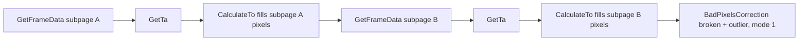

# mlx90640

How the firmware talks to the thermal sensor: the vendored Melexis API, the Wire I²C shim, frame reading, settings and error codes.

## Files

- `lib/MLX90640/MLX90640_API.cpp`, `MLX90640_API.h`, `MLX90640_I2C_Driver.h`: Melexis' official API, copied **unchanged** from `pimoroni/mlx90640-library` at commit `a92229a` (Apache 2.0, `lib/MLX90640/LICENSE`). Keep them unmodified so they can be diffed against upstream; put fixes in the shim or `main.cpp`.
- `lib/MLX90640/MLX90640_I2C_Driver.cpp`: the only project-written file. Implements `MLX90640_I2CInit/Read/Write/FreqSet` on Arduino `Wire`.
- `docs/mlx90640-library/`: the upstream repo as a submodule, with `MLX90640 driver.pdf` (Melexis' driver doc) and Raspberry Pi examples. Reference only, not built.
- `docs/mlx90640.py`: Pimoroni's MicroPython port (Tufty badge). Reference only.

## I²C shim details

- Registers and data are 16-bit big-endian words.
- The ESP32 `Wire` buffer is 128 bytes, so reads are split into 32-word (64-byte) chunks, each with its own address write + repeated start. Frame and EEPROM reads are 832 words.
- `MLX90640_I2CFreqSet` takes **kHz**.
- `MLX90640_I2CWrite` reads the register back and returns `-2` on mismatch, like the reference drivers. Writes to the status register (0x8000) always mismatch; the API ignores `-2` there and only treats `-1` (NACK) as fatal.
- `Wire.setPins()` + `Wire.begin()` happen in `setup()` before any API call.

## Startup sequence (`setup()`)

1. Probe 0x33 with an empty transmission → "MLX90640 not found".
2. `MLX90640_DumpEE` at **400 kHz** → "EEPROM read failed".
3. `MLX90640_ExtractParameters` → "Bad calibration" (non-zero = too many bad pixels or corrupt EEPROM, usually a marginal bus).
4. Raise the bus to 1 MHz (`I2C_KHZ`), set chess mode, 18-bit ADC, refresh rate.

## Frame reading (`readFrame()`)

- One `GetFrameData` = one subpage (half the pixels in a chess pattern). A full image needs **two** calls; `CalculateTo` only writes the pixels of the subpage just read, into the shared `frame[768]`.
- `GetFrameData` busy-waits on the status register's data-ready bit (5 s timeout via `std::chrono`, which works on ESP-IDF) and returns the subpage number, or < 0 on error.
- Reflected temperature is `Ta - TA_SHIFT` (8 °C, Melexis' open-air recommendation). `EMISSIVITY` is 0.95.
- `BadPixelsCorrection` mode `1` interpolates from neighbours in the chess layout. The lists end with `0xFFFF`.
- `frame[]` is in sensor order (`row * 32 + col`). Display orientation is applied later by `px(x, y)` in `main.cpp`.

## Settings and their effect

| Define | Value | Notes |
|---|---|---|
| `MLX_RATE` | `0x05` (16 Hz subpages) | ~7.9 fps measured. `0x04` = 8 Hz, ~4 fps, less noise. Codes: `0x00` 0.5 Hz … `0x07` 64 Hz. |
| `MLX_ADC_18` | `0x02` | `0x00` 16-bit … `0x03` 19-bit. |
| `I2C_KHZ` | `1000` | Drop to 400 with long wires. |

At 16 Hz one full frame takes ~125 ms on the sensor side; reading both subpages' I²C traffic plus `CalculateTo` (~46 ms per full frame, soft-float) fits with little headroom. Faster rates won't raise fps without cutting compute.
